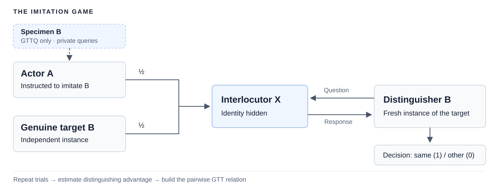

# Generalizing the Turing Test to Interactive Agents

**Daniel Mitropolsky · Riccardo Neumarker<sup>†</sup> · Emanuele Rimoldi<sup>†</sup> · Susan S. Hong · Tomaso Poggio**<br>
<sup>†</sup>Equal contribution

[Paper](https://arxiv.org/abs/2605.10851) · [Interactive explorer](https://turing.gtt-explorer.workers.dev/) · [Reproduction guide](REPRODUCIBILITY.md) · [Data](data/README.md)

Research code used to launch the paper's experiments and implement its **Generalized Turing Test (GTT)** framework: role prompts, interactive protocols, transcript collection, pairwise comparison, and relation graphs.

The GTT asks whether an actor **A** can imitate a target **B** well enough to fool a fresh instance of **B**. **GTTQ** first lets the actor query a specimen of the target; **UTT** uses a separate distinguisher **D**.



The comparator is $A \geq_{\epsilon} B$ when the distinguisher's probability of a correct decision is at most $\frac{1}{2}+\epsilon$. The analysis code estimates this relation and explores its graph structure and transitivity.

## Run experiments

Use Python 3.11. Hosted experiments use OpenRouter and require an API key.

```bash
git clone https://github.com/EmaRimoldi/generalized-turing-test.git
cd generalized-turing-test
python3 -m venv .venv
source .venv/bin/activate
python -m pip install -r requirements.txt
export OPENROUTER_API_KEY="<your-key>"

python run_experiment.py \
  --actor claude-opus-4.6 --distinguisher gemini-3-pro \
  --condition no_query_no_explanation \
  --num-trials 40 --turn-limit 40 --output-dir results/gtt
```

The baseline schedules below encode the nine-model grid and trial budgets from Appendix B.1. They are reconstructed launch configurations, rather than the original execution manifests. These commands make paid model calls.

```bash
python run_experiment_batch.py --csv configs/paper_gtt.csv --output-dir results/gtt
python run_experiment_batch.py --csv configs/paper_gttq.csv --output-dir results/gttq
```

See the [reproduction guide](REPRODUCIBILITY.md) for controlled budgets, UTT, output semantics, and the Apptainer environment.

## Explore the included results

With Node.js 22.12+ and Python available:

```bash
npm --prefix visualizer/web ci
npm --prefix visualizer/web run build
python3 visualizer/scripts/serve_epsilon_visualizer.py
```

Open [localhost:8765](http://127.0.0.1:8765/). This rebuilds the explorer offline from the two committed grouped inputs.

**Data coverage.** The included GTT/GTTQ snapshots each contain 81 ordered pairs with 10 trials per pair. They preserve an earlier experiment snapshot and do not contain the paper's full final sample. Full transcripts and results for the additional paper experiments are not bundled here. See [data provenance and limitations](data/README.md).

## Repository

| Path | Purpose |
| --- | --- |
| [`turing_eval/`](turing_eval/) | Protocols, prompts, model routing, and transcript persistence |
| [`run_experiment.py`](run_experiment.py) | Single pair; [`batch`](run_experiment_batch.py) and [`matrix`](run_experiment_matrix.py) launchers |
| [`configs/`](configs/) | Paper baseline launch schedules |
| [`visualizer/`](visualizer/README.md) | Pairwise estimates, relation graphs, transitivity, and web explorer |
| [`data/`](data/README.md) | Data inventory and retained pilot CSVs |
| [`tests/`](tests/) | Offline protocol and analysis checks |

Validate locally with `python -m pytest tests/ -q` and the frontend build above.

## Citation

```bibtex
@misc{mitropolsky2026generalizing,
  title={Generalizing the Turing Test to Interactive Agents},
  author={Daniel Mitropolsky and Riccardo Neumarker and Emanuele Rimoldi and Susan S. Hong and Tomaso Poggio},
  year={2026},
  eprint={2605.10851},
  archivePrefix={arXiv},
  primaryClass={cs.AI},
  url={https://arxiv.org/abs/2605.10851}
}
```
